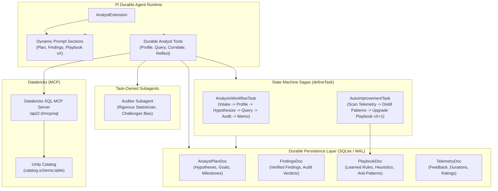

# DataClaw

A data analyst that does not forget the work when the process dies. The plan, the findings, and the playbook are checkpointed in SQLite. A live console shows the turn as it happens. Databricks stays read-only, over MCP. A skeptical auditor checks the claim before it ships.

Built with [Pi Durable](https://github.com/earendil-works/pi-durable) and Bun.

Unlike ephemeral agents whose scratchpads vanish when a server restarts, DataClaw treats analytical plans, discovered insights, dataset profiles, human feedback, and learned heuristics as **atomic, checkpointed durable documents**.

---

## 1. System Architecture



---

## 2. Core Capabilities

### 🔍 1. Exploratory Data Profiling & SQL Engine
- Safe, sandboxed read-only query execution across CSV, JSON, and SQLite datasets.
- Schema inference, null percentages, distinct values, and column distribution profiling.
- Built-in statistical calculations (Pearson correlation, percentile distributions).

### 🛡️ 2. Crash-Resilience & Exactly-Once Durability
- Atomic SQLite commits ensure no data loss during machine restarts, host crashes, or network interruptions.
- Idempotent request IDs and task states allow tasks to resume from their exact checkpoints using `harness.resume()`.

### 🧠 3. Closed-Loop Auto-Improvement (Institutional Memory)
- **Continuous Feedback Capture**: Stores post-mortem self-reflections, auditor corrections, and human reviewer feedback ratings (1-5 stars) in `TelemetryDoc`.
- **Durable `AutoImprovementTask`**: A multi-phase state machine that scans past telemetry, identifies recurring failure modes (e.g., small sample sizes, Simpson's paradox, unsegmented cohorts), and synthesizes new domain heuristics into `PlaybookDoc`.
- **Dynamic System Prompt Injection**: Upgraded playbook rules (e.g. Version 2, Version 3) are injected directly into the LLM system prompt via `section("auto_improving_playbook")` on every subsequent turn!

### 🕵️ 4. Task-Owned Auditor Subagent
- Spawns a dedicated, skeptical statistical auditor subagent (`request_auditor_review`) owned by `api.taskId`.
- Scrutinizes findings for p-hacking, confirmation bias, confounding variables, or sample size deficiencies before claims are presented.

### 🧱 5. Databricks over MCP (Unity Catalog)
- Connects to the **Databricks-managed SQL MCP server** at `https://<workspace>/api/2.0/mcp/sql` over streamable HTTP.
- Authenticates with `DATABRICKS_HOST`/`DATABRICKS_TOKEN`, the local **Databricks CLI profile** (OAuth token refresh
  included), **browser OAuth** (authorization code + PKCE), or a **service principal** (client credentials).
- Exposes durable tools to the analyst team: `connect_databricks`, `query_databricks`, `list_databricks_assets`, and `profile_databricks_table`.
- **Read-only by construction**: the adapter selects `execute_sql_read_only`, rejects mutating SQL, and blocks multi-statement writes before anything reaches the warehouse.
- Profiles Unity Catalog tables with `DESCRIBE TABLE` plus one aggregate query (nulls, distincts, min/max/mean/median), and uses native `corr` / `percentile_approx` for statistics.
- The active connection is recorded in `AnalystPlanDoc.databricks` (host, MCP URL, profile, warehouse) so resumed runs know where the data came from. Tokens are never persisted.

---

## 3. Quickstart & Demos

### Prerequisites
- [Bun](https://bun.sh) (v1.2+) or Node.js (v22+)
- (Optional) A model. DataClaw reads `.pi/settings.json`, then `~/.pi/agent/settings.json`, and the saved credential in `~/.pi/agent/auth.json`. This repo pins OpenCode Go:
  ```json
  { "defaultProvider": "opencode-go", "defaultModel": "deepseek-v4.1-flash" }
  ```
  `DEFAULT_MODEL_PROVIDER` and `DEFAULT_MODEL_ID` override that file. `OPENCODE_API_KEY`, `OPENAI_API_KEY`, `ANTHROPIC_API_KEY`, `GEMINI_API_KEY`, or `OPENROUTER_API_KEY` are used when Pi has no credential for the provider. With none of these, the console stays on the offline faux model.

- (Optional) Databricks access for the Unity Catalog data source:
  ```bash
  # Either export workspace credentials...
  export DATABRICKS_HOST="https://dbc-xxxx.cloud.databricks.com"
  export DATABRICKS_TOKEN="dapi..."
  # ...or use a logged-in Databricks CLI profile (default: DEFAULT)
  databricks auth login --profile DEFAULT
  ```
  See `.env.example` for all Databricks variables.

### Run Tests
```bash
bun test
```

### Run Demonstration Scripts

1. **Auto-Improvement Loop Demo** (Shows Playbook upgrading from v1 to v2 based on feedback):
   ```bash
   bun run demo:auto-improve
   ```

2. **Crash Resilience & Resumption Demo** (Simulates mid-analysis process termination and recovery):
   ```bash
   bun run demo:resilience
   ```

3. **End-to-End Analysis Demo**:
   ```bash
   bun run demo
   ```

4. **Databricks over MCP Demo** (discovers catalogs, profiles a Unity Catalog table, runs a query):
   ```bash
   bun run demo:databricks
   # or target a table:
   bun run demo:databricks samples.nyctaxi.trips
   ```

---

## 4. CLI Usage

Run the built-in CLI against real tabular data:

```bash
# Analyze sample customer churn dataset
bun run cli analyze sample-data/customer_churn.csv "Identify primary churn indicators"

# Inspect the verified findings
bun run cli findings

# Inspect active analytical plan & hypotheses
bun run cli plan

# Trigger the auto-improvement task
bun run cli auto-improve "retention_strategy"

# View the upgraded institutional playbook
bun run cli playbook
```

### Databricks commands

```bash
# Show the resolved workspace and MCP endpoint
bun run cli databricks-status

# Discover Unity Catalog assets
bun run cli databricks-catalogs
bun run cli databricks-schemas samples
bun run cli databricks-tables samples nyctaxi
bun run cli databricks-describe samples.nyctaxi.trips

# Profile a table (rows, nulls, distributions) and run read-only SQL
bun run cli databricks-profile samples.nyctaxi.trips
bun run cli databricks-query "SELECT pickup_zip, COUNT(*) FROM samples.nyctaxi.trips GROUP BY pickup_zip LIMIT 5"
```

The durable agent can attach Databricks on startup with `DATABRICKS_AUTO_CONNECT=true`, or at runtime by calling the
`connect_databricks` tool. In this repo, `.pi/mcp.json` also registers the same endpoint for pi sessions and subagents;
its bearer token is minted from `databricks auth token` at connect time, so run `/mcp reconnect databricks` if a long
session outlives the token.

> **Security:** only read-only SQL is allowed. `execute_sql_read_only` is preferred, mutating keywords are rejected,
> and multi-statement writes are blocked before the call leaves the process.

### Console auth UI

The prototype console wraps Databricks authentication in a UI:

```bash
bun run prototype
# open http://localhost:3000/prototype/settings or /prototype/data
```

- The topbar **Connect Databricks** button (and Settings → Databricks Unity Catalog) opens the auth panel.
- **CLI profile** tab lists profiles from `~/.databrickscfg` and connects with the profile's OAuth token.
- **OAuth** tab offers two flows:
  - **Browser sign-in** — OAuth 2.0 authorization code + PKCE using Databricks' public `databricks-cli` client.
    It opens the workspace login page and completes on a short-lived `localhost:8020` callback, then refreshes
    tokens automatically. The console and browser must run on the same machine.
  - **Service principal** — OAuth client-credentials (M2M) for unattended agents. The service principal needs
    workspace access and the `sql` scope.
- **Access token** tab accepts a workspace URL + PAT for environments without a CLI login or OAuth app.
- Connected state shows the resolved identity (`SELECT current_user()`), visible catalogs, MCP endpoint, auth method,
  and token expiry, with **Refresh token** and **Disconnect** actions.
- The console server binds to `127.0.0.1` by default because the auth endpoints can mint warehouse sessions.
  Set `HOST=0.0.0.0` only if you intentionally want remote access.

The HTTP surface is intentionally small: `GET /api/databricks/status`, `POST /api/databricks/connect`,
`POST /api/databricks/reconnect`, `POST /api/databricks/disconnect`, `POST /api/databricks/oauth/start`,
`GET /api/databricks/oauth/status`, and `POST /api/databricks/oauth/cancel`.
Tokens and OAuth refresh tokens are held in server memory only.

> Restart `bun run prototype` after changing server routes. Bun's HMR reloads the React client, but a
> long-running server process keeps its existing route table.

---

## 5. Project Structure

```
dataclaw/
├── src/
│   ├── index.ts                     # Main entrypoint & public exports
│   ├── cli.ts                       # Interactive CLI runner
│   ├── config.ts                    # Multi-provider model configuration (OpenAI, Anthropic, Gemini, Faux)
│   ├── harness.ts                   # Bootstraps Harness, SQLite storage, registry, and resumption
│   ├── prototype/                   # Stillwork console (Bun.serve + React)
│   │   ├── server.ts                # HTML routes + Databricks auth API
│   │   ├── DatabricksAuth.tsx       # Auth modal, status card, and client hook
│   │   └── databricks-api.ts        # Server-side session manager for the auth UI
│   ├── docs/                        # Durable Document Schemas (defineDoc)
│   │   ├── plan.ts                  # AnalystPlanDoc (active goal, hypotheses, milestones)
│   │   ├── findings.ts              # FindingsDoc (verified insights, evidence, audit verdicts)
│   │   ├── playbook.ts              # PlaybookDoc (learned heuristics, anti-patterns, templates)
│   │   └── telemetry.ts             # TelemetryDoc (feedback ratings, error logs, reflections)
│   ├── tools/                       # Replayable agent tools
│   │   ├── analyst-tools.ts         # profile_dataset, run_analytical_query, calculate_metric, etc.
│   │   ├── databricks-tools.ts      # connect/query/discover/profile Databricks via MCP
│   │   └── auto-improve-tools.ts    # record_reflection, record_feedback, promote_rule, etc.
│   ├── mcp/                         # MCP transport & auth
│   │   ├── databricks-config.ts     # DATABRICKS_* / ~/.databrickscfg / CLI token resolution
│   │   ├── databricks-oauth.ts      # PKCE browser flow + service-principal client credentials
│   │   └── mcp-sql-client.ts        # streamable HTTP JSON-RPC client, polling, result decoding
│   ├── tasks/                       # Durable state machines (defineTask)
│   │   ├── analysis-workflow.ts     # AnalysisWorkflowTask (Intake -> Profile -> Query -> Audit -> Memo)
│   │   └── auto-improvement.ts     # AutoImprovementTask (Scan -> Distill -> Upgrade Playbook)
│   ├── subagents/                   # Task-owned subagents
│   │   └── auditor-subagent.ts      # Statistical critic subagent
│   ├── extensions/                  # Extensions & dynamic prompt sections
│   │   └── analyst-extension.ts     # Injects hypotheses, findings, and Playbook into system prompt
│   └── adapters/                    # Data connectors
│       ├── adapter-interface.ts     # DataAdapter interface
│       ├── sqlite-adapter.ts        # Fast SQLite / CSV / JSON query engine
│       └── databricks-adapter.ts    # Read-only Unity Catalog adapter over MCP
├── examples/                        # Executable demonstrations
│   ├── auto-improve-demo.ts         # Live closed-loop self-refinement run
│   ├── crash-resilience-demo.ts     # Crash simulation and seamless resumption
│   ├── databricks-demo.ts           # Databricks-over-MCP discovery, profiling, querying
│   └── demo-run.ts                  # Full analysis pipeline run
├── .pi/mcp.json                     # Registers the Databricks SQL MCP for pi sessions/subagents
├── .env.example                     # Databricks + model provider environment template
├── sample-data/
│   ├── customer_churn.csv           # B2B customer retention dataset
│   └── incident_logs.json           # Distributed systems observability logs
└── tests/                           # Unit & integration test suite
    ├── docs.test.ts                 # Tests for durable documents
    ├── sqlite-adapter.test.ts       # Tests for data profiling & query engine
    ├── databricks-mcp.test.ts       # MCP client, SQL safety, OAuth helpers, and adapter tests
    ├── databricks-oauth-flow.test.ts # End-to-end browser OAuth callback + MCP connect (mock workspace)
    ├── workflow.test.ts             # Tests for AnalysisWorkflowTask
    └── auto-improvement.test.ts     # Tests for AutoImprovementTask
```
