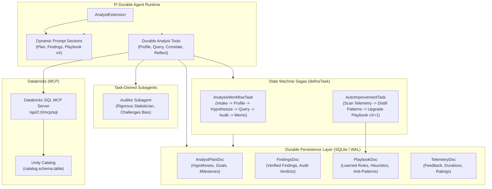

# DataClaw

DataClaw is a data analyst agent that keeps its work. Its plan, findings, audit verdicts, and playbook are stored as
durable documents in SQLite, so a restart resumes the analysis instead of starting it over. It queries local CSV/JSON
files or Databricks Unity Catalog (read-only, over MCP), and a skeptical auditor subagent reviews each finding before
it counts as confirmed. Built with [Pi Durable](https://github.com/earendil-works/pi-durable) and Bun.

This README covers how I evaluate the agent: what counts as a good run, how to tell when it gets stuck, and what a
correct answer costs. The agent itself is described further down.

## The problem

When an analyst agent answers "Basic tier churn is 71%", three questions matter:

1. **Is the answer right?** Reading the reply doesn't tell you. The number has to be checked against the data.
2. **Did it get stuck along the way?** An agent that re-runs the same query five times, or keeps hitting SQL
   errors, burns tokens and the user's time even when it gets there in the end.
3. **What did a correct answer cost?** Cost per run hides failures. The useful number is cost per *successful*
   answer.

The agent already records what's needed to answer all three: every tool call with its arguments, result, error flag,
and duration; token usage per model call; and each finding with the auditor's verdict. `evals/` reads those records.
It doesn't add any new logging.

## Method

**Tasks.** [`evals/tasks.ts`](evals/tasks.ts) has nine questions about the two sample datasets ("What share of
Basic tier customers churned?", "Which incident lasted the longest?"). Each one has a reference SQL query, and the
expected answer is computed by running that query on the data, so ground truth can't drift from the data. The agent
must end its reply with `ANSWER: <value>`. Numbers are graded within 1% (2% for the correlation task), and a
proportion is also accepted written as a percentage.

**Trace.** [`evals/trace.ts`](evals/trace.ts) flattens the stored transcript into tool calls (name, canonical
arguments, error flag, duration), the final reply, and the findings with their audit verdicts.

**Stuck detector.** A run counts as stuck if any of these is true. None of them needs ground truth, so the same
detector works on production traces:

| Signal | Definition (defaults) |
| --- | --- |
| `repeated_call` | the same tool with the same arguments, 3 or more times |
| `error_streak` | 3 or more tool errors in a row |
| `tool_budget` | more than 25 tool calls |
| `no_final_answer` | the run ends with no text reply, or with a provider error or abort |

There's a separate quality flag for runs that *answered after the auditor rejected their finding* and never recorded
a revised one.

**Metrics** ([`evals/report.ts`](evals/report.ts)):

- success rate
- tasks solved in every repeat and in any repeat
- spread of the success rate across repeats
- flaky tasks
- stuck rate, and success with and without being stuck
- tool error rate
- tokens per run
- cost per successful answer
- latency p50 and p90

**Statistics** ([`evals/stats.ts`](evals/stats.ts), no dependencies, seeded):

- Repeats of the same task are correlated, so confidence intervals come from a percentile bootstrap that resamples
  *tasks*, not runs.
- Comparing two variants adds:
  - a sample ratio mismatch check (chi-square against the planned split)
  - the success-rate difference with a Newcombe interval and a task-paired bootstrap interval
  - Cohen's h as the effect size
  - bootstrap intervals on the stuck-rate and cost-per-success differences
- `tests/evals.test.ts` checks these functions against published values (Newcombe 1998, chi-square critical
  values, a textbook kappa).

**Judge calibration.** The auditor is DataClaw's LLM-as-judge: it rates each finding as confirmed, caution, or
rejected. A judge is only worth trusting once it agrees with people. [`evals/calibrate.ts`](evals/calibrate.ts)
works in two steps:

1. It exports every audited finding to a CSV *without* the auditor's verdict, so labeling is blind.
2. It joins the human labels back and reports raw agreement, a confusion matrix, and Cohen's kappa with a bootstrap
   CI.

**Two modes.**

- `bun run evals` runs offline. It uses the real harness, tools, SQLite engine, and auditor subagent, but the model
  is a scripted agent ([`evals/scripted-agent.ts`](evals/scripted-agent.ts)). The script reads its answer out of the
  tool result it receives, and it fails at fixed, injected rates: it skips profiling, writes a SQL typo, loops on the
  same query, records a finding without its query, or misreports the number.
- `bun run evals --model <provider>/<model>` runs a real model through the same pipeline.

## Results

### 1. Four bugs found while building the evals (real)

The first and third showed up as failed eval runs. The other two came up while reading the code the trace depends
on. Each fix has a test.

| Bug | Effect | Fix |
| --- | --- | --- |
| Tools returned results under `content`, which Pi Durable 1.3 ignores | **The model never saw a query result, profile, metric, or audit report.** It only saw progress lines like "Executing query: …" | return `output` ([tests/tool-output.test.ts](tests/tool-output.test.ts)) |
| Tool errors were returned as normal text | SQL errors were invisible in the trace as errors | set `isError` |
| `record_finding` wrote `query: undefined` when the model left out the optional query | the call failed and the finding was lost | only set optional fields when they're present |
| The audit verdict was matched with `/REJECTED/` anywhere in the reply, and defaulted to confirmed | a reply that echoed the `[CONFIRMED \| CAUTION \| REJECTED]` template counted as rejected, and an empty reply counted as confirmed | read the `VERDICT:` line, and treat a reply without one as caution |

I measured the first two by running the same offline eval (same seeds, same injected faults) on the original commit:

| | original commit `a97316a` | this branch |
| --- | --- | --- |
| Scripted-agent success (90 runs) | 0 / 90 | 79 / 90 |
| Tool error rate, baseline variant | 1.9% | 5.3% |

The scripted agent copies its answer from the query result, so 0/90 means the result never reached it. A real model
would have had to make up every number. The tool error rate went *up* after the fix because injected SQL errors
became visible.

To reproduce the left column:

```bash
git worktree add ../dataclaw-before a97316a
cp -r evals ../dataclaw-before/
cd ../dataclaw-before && bun install
bun run evals/run.ts --out /tmp/before
```

### 2. Offline eval report (synthetic: scripted agent, injected faults)

> These numbers check the measurement pipeline. They don't measure any model. `candidate` is the same script with
> lower injected rates for looping, skipped profiling, and unsupported claims. Costs use a nominal price: $0.50 per
> million input tokens, $2 per million output tokens, and $0.05 per million cache-read tokens. Reproduce with
> `bun run evals`. Every number except latency is deterministic. Full report:
> [evals/results/scripted-report.md](evals/results/scripted-report.md).

| Metric | baseline | candidate |
| --- | --- | --- |
| Runs (tasks × repeats) | 45 (9 × 5) | 45 (9 × 5) |
| Success rate [95% CI] | 84.4% [71.1%, 95.6%] | 91.1% [82.2%, 100.0%] |
| Tasks solved in every repeat | 44.4% | 66.7% |
| Success rate by repeat (min–max) | 77.8%–88.9% | 77.8%–100.0% |
| Stuck rate [95% CI] | 26.7% [13.3%, 40.0%] | 2.2% [0.0%, 6.7%] |
| Success when stuck / not stuck | 50.0% / 97.0% | 100.0% / 90.9% |
| Answered despite a rejected finding | 11.1% | 0.0% |
| Cost per success [95% CI] (nominal) | $0.0113 [$0.0103, $0.0131] | $0.0107 [$0.0099, $0.0119] |

| candidate vs baseline | Result |
| --- | --- |
| Sample ratio check | 45 vs 45, p = 1.00 |
| Success difference, task bootstrap 95% CI | +6.7 pp [−11.1 pp, +24.4 pp] |
| Cohen's h | 0.21 |
| Stuck-rate difference, task bootstrap 95% CI | −24.4 pp [−40.0 pp, −8.9 pp] |

What this shows about the method (not about a model):

- **Nine tasks with five repeats each can't detect a 7-point gain in success rate.** The interval runs from −11 to
  +24 points. The same set does detect the change in stuck rate, because looping is a frequent, direct signal. Before
  shipping, run a power calculation, or use a more sensitive metric.
- **Repeats matter.** Every task was solved at least once in both variants, but fewer than half (baseline) or two
  thirds (candidate) were solved in every repeat. A single run per task would have overstated reliability.
- **The stuck detector can't see confident wrong answers.** The candidate's failures are all misreported numbers,
  which is why its "not stuck" success rate is below 100%. Catching those needs ground truth offline, and a
  calibrated judge online.
- In this offline setup, the stub auditor confirms findings that cite a query even when the number is wrong. That's
  the kind of judge blind spot the calibration step exists to measure on real labels.

### 3. Real-model results: not run yet

No model credentials were available where this report was produced, so there are no real-model numbers here. To
produce them:

```bash
# any provider Pi knows: opencode-go, openai, anthropic, google, openrouter
export OPENAI_API_KEY=...            # or log in with pi
bun run evals --model openai/gpt-4o --repeats 3
# writes evals/results/model-openai_gpt-4o.jsonl and a report next to it

# compare two models or prompts run on the same tasks
bun run evals:report evals/results/model-A.jsonl evals/results/model-B.jsonl

# calibrate the auditor: export, label human_label as confirmed/caution/rejected, score
bun run evals:calibrate export evals/results/model-openai_gpt-4o.jsonl > labels.csv
bun run evals:calibrate score labels.csv evals/results/model-openai_gpt-4o.jsonl
```

`evals/labels/auditor-labels.example.csv` shows the label format. Its labels are placeholders produced by a rule
(rejected if the finding has no query or a wrong number) and are marked `EXAMPLE`. The score command prints a
warning when it sees them.

## Limitations

- The task set is nine questions on two toy datasets, which is too small for any claim about a model.
- The offline numbers come from a scripted agent. They show that the metrics compute correctly, not that any agent
  is good.
- The stuck thresholds (3, 3, 25) are defaults I picked, not tuned against labeled sessions.
- Latency in offline mode is local wall clock and isn't comparable across machines.
- `bunx tsc --noEmit` reports type errors across the original codebase, mostly from the document typings; the new
  `evals/` code typechecks. `bun test` is green.

---

# The agent

## Architecture



## Capabilities

### Exploratory Data Profiling & SQL Engine
- Safe, sandboxed read-only query execution across CSV, JSON, and SQLite datasets.
- Schema inference, null percentages, distinct values, and column distribution profiling.
- Built-in statistical calculations (Pearson correlation, percentile distributions).

### Crash-Resilience & Exactly-Once Durability
- Atomic SQLite commits ensure no data loss during machine restarts, host crashes, or network interruptions.
- Idempotent request IDs and task states allow tasks to resume from their exact checkpoints using `harness.resume()`.

### Closed-Loop Auto-Improvement (Institutional Memory)
- **Continuous Feedback Capture**: Stores post-mortem self-reflections, auditor corrections, and human reviewer feedback ratings (1-5 stars) in `TelemetryDoc`.
- **Durable `AutoImprovementTask`**: A multi-phase state machine that scans past telemetry, identifies recurring failure modes (e.g., small sample sizes, Simpson's paradox, unsegmented cohorts), and synthesizes new domain heuristics into `PlaybookDoc`.
- **Dynamic System Prompt Injection**: Upgraded playbook rules (e.g. Version 2, Version 3) are injected directly into the LLM system prompt via `section("auto_improving_playbook")` on every subsequent turn!

### Task-Owned Auditor Subagent
- Spawns a dedicated, skeptical statistical auditor subagent (`request_auditor_review`) owned by `api.taskId`.
- Scrutinizes findings for p-hacking, confirmation bias, confounding variables, or sample size deficiencies before claims are presented.

### Databricks over MCP (Unity Catalog)
- Connects to the **Databricks-managed SQL MCP server** at `https://<workspace>/api/2.0/mcp/sql` over streamable HTTP.
- Authenticates with `DATABRICKS_HOST`/`DATABRICKS_TOKEN`, the local **Databricks CLI profile** (OAuth token refresh
  included), **browser OAuth** (authorization code + PKCE), or a **service principal** (client credentials).
- Exposes durable tools to the analyst team: `connect_databricks`, `query_databricks`, `list_databricks_assets`, and `profile_databricks_table`.
- **Read-only by construction**: the adapter selects `execute_sql_read_only`, rejects mutating SQL, and blocks multi-statement writes before anything reaches the warehouse.
- Profiles Unity Catalog tables with `DESCRIBE TABLE` plus one aggregate query (nulls, distincts, min/max/mean/median), and uses native `corr` / `percentile_approx` for statistics.
- The active connection is recorded in `AnalystPlanDoc.databricks` (host, MCP URL, profile, warehouse) so resumed runs know where the data came from. Tokens are never persisted.

## Quickstart

### Prerequisites
- [Bun](https://bun.sh) (v1.2+) or Node.js (v22+)
- (Optional) A model. DataClaw reads `.pi/settings.json`, then `~/.pi/agent/settings.json`, and the saved credential in `~/.pi/agent/auth.json`. This repo pins OpenCode Go:
  ```json
  { "defaultProvider": "opencode-go", "defaultModel": "deepseek-v4.1-flash" }
  ```
  `DEFAULT_MODEL_PROVIDER` and `DEFAULT_MODEL_ID` override that file. `OPENCODE_API_KEY`, `OPENAI_API_KEY`, `ANTHROPIC_API_KEY`, `GEMINI_API_KEY`, or `OPENROUTER_API_KEY` are used when Pi has no credential for the provider. With none of these, the console stays on the offline faux model.

- (Optional) Databricks access for the Unity Catalog data source:
  ```bash
  # Either export workspace credentials...
  export DATABRICKS_HOST="https://dbc-xxxx.cloud.databricks.com"
  export DATABRICKS_TOKEN="dapi..."
  # ...or use a logged-in Databricks CLI profile (default: DEFAULT)
  databricks auth login --profile DEFAULT
  ```
  See `.env.example` for all Databricks variables.

### Run tests and evals
```bash
bun test
bun run evals          # offline, synthetic; see "Results" above
```

### Run Demonstration Scripts

1. **Auto-Improvement Loop Demo** (Shows Playbook upgrading from v1 to v2 based on feedback):
   ```bash
   bun run demo:auto-improve
   ```

2. **Crash Resilience & Resumption Demo** (Simulates mid-analysis process termination and recovery):
   ```bash
   bun run demo:resilience
   ```

3. **End-to-End Analysis Demo**:
   ```bash
   bun run demo
   ```

4. **Databricks over MCP Demo** (discovers catalogs, profiles a Unity Catalog table, runs a query):
   ```bash
   bun run demo:databricks
   # or target a table:
   bun run demo:databricks samples.nyctaxi.trips
   ```

---

## CLI

Run the built-in CLI against real tabular data:

```bash
# Analyze sample customer churn dataset
bun run cli analyze sample-data/customer_churn.csv "Identify primary churn indicators"

# Inspect the verified findings
bun run cli findings

# Inspect active analytical plan & hypotheses
bun run cli plan

# Trigger the auto-improvement task
bun run cli auto-improve "retention_strategy"

# View the upgraded institutional playbook
bun run cli playbook
```

### Databricks commands

```bash
# Show the resolved workspace and MCP endpoint
bun run cli databricks-status

# Discover Unity Catalog assets
bun run cli databricks-catalogs
bun run cli databricks-schemas samples
bun run cli databricks-tables samples nyctaxi
bun run cli databricks-describe samples.nyctaxi.trips

# Profile a table (rows, nulls, distributions) and run read-only SQL
bun run cli databricks-profile samples.nyctaxi.trips
bun run cli databricks-query "SELECT pickup_zip, COUNT(*) FROM samples.nyctaxi.trips GROUP BY pickup_zip LIMIT 5"
```

The durable agent can attach Databricks on startup with `DATABRICKS_AUTO_CONNECT=true`, or at runtime by calling the
`connect_databricks` tool. In this repo, `.pi/mcp.json` also registers the same endpoint for pi sessions and subagents;
its bearer token is minted from `databricks auth token` at connect time, so run `/mcp reconnect databricks` if a long
session outlives the token.

> **Security:** only read-only SQL is allowed. `execute_sql_read_only` is preferred, mutating keywords are rejected,
> and multi-statement writes are blocked before the call leaves the process.

### Console auth UI

The prototype console wraps Databricks authentication in a UI:

```bash
bun run prototype
# open http://localhost:3000/prototype/settings or /prototype/data
```

- The topbar **Connect Databricks** button (and Settings → Databricks Unity Catalog) opens the auth panel.
- **CLI profile** tab lists profiles from `~/.databrickscfg` and connects with the profile's OAuth token.
- **OAuth** tab offers two flows:
  - **Browser sign-in** — OAuth 2.0 authorization code + PKCE using Databricks' public `databricks-cli` client.
    It opens the workspace login page and completes on a short-lived `localhost:8020` callback, then refreshes
    tokens automatically. The console and browser must run on the same machine.
  - **Service principal** — OAuth client-credentials (M2M) for unattended agents. The service principal needs
    workspace access and the `sql` scope.
- **Access token** tab accepts a workspace URL + PAT for environments without a CLI login or OAuth app.
- Connected state shows the resolved identity (`SELECT current_user()`), visible catalogs, MCP endpoint, auth method,
  and token expiry, with **Refresh token** and **Disconnect** actions.
- The console server binds to `127.0.0.1` by default because the auth endpoints can mint warehouse sessions.
  Set `HOST=0.0.0.0` only if you intentionally want remote access.

The HTTP surface is intentionally small: `GET /api/databricks/status`, `POST /api/databricks/connect`,
`POST /api/databricks/reconnect`, `POST /api/databricks/disconnect`, `POST /api/databricks/oauth/start`,
`GET /api/databricks/oauth/status`, and `POST /api/databricks/oauth/cancel`.
Tokens and OAuth refresh tokens are held in server memory only.

> Restart `bun run prototype` after changing server routes. Bun's HMR reloads the React client, but a
> long-running server process keeps its existing route table.

## Project structure

```
dataclaw/
├── src/
│   ├── index.ts                     # Main entrypoint & public exports
│   ├── cli.ts                       # Interactive CLI runner
│   ├── config.ts                    # Multi-provider model configuration (OpenAI, Anthropic, Gemini, Faux)
│   ├── harness.ts                   # Bootstraps Harness, SQLite storage, registry, and resumption
│   ├── prototype/                   # Stillwork console (Bun.serve + React)
│   │   ├── server.ts                # HTML routes + Databricks auth API
│   │   ├── DatabricksAuth.tsx       # Auth modal, status card, and client hook
│   │   └── databricks-api.ts        # Server-side session manager for the auth UI
│   ├── docs/                        # Durable Document Schemas (defineDoc)
│   │   ├── plan.ts                  # AnalystPlanDoc (active goal, hypotheses, milestones)
│   │   ├── findings.ts              # FindingsDoc (verified insights, evidence, audit verdicts)
│   │   ├── playbook.ts              # PlaybookDoc (learned heuristics, anti-patterns, templates)
│   │   └── telemetry.ts             # TelemetryDoc (feedback ratings, error logs, reflections)
│   ├── tools/                       # Replayable agent tools
│   │   ├── analyst-tools.ts         # profile_dataset, run_analytical_query, calculate_metric, etc.
│   │   ├── databricks-tools.ts      # connect/query/discover/profile Databricks via MCP
│   │   └── auto-improve-tools.ts    # record_reflection, record_feedback, promote_rule, etc.
│   ├── mcp/                         # MCP transport & auth
│   │   ├── databricks-config.ts     # DATABRICKS_* / ~/.databrickscfg / CLI token resolution
│   │   ├── databricks-oauth.ts      # PKCE browser flow + service-principal client credentials
│   │   └── mcp-sql-client.ts        # streamable HTTP JSON-RPC client, polling, result decoding
│   ├── tasks/                       # Durable state machines (defineTask)
│   │   ├── analysis-workflow.ts     # AnalysisWorkflowTask (Intake -> Profile -> Query -> Audit -> Memo)
│   │   └── auto-improvement.ts     # AutoImprovementTask (Scan -> Distill -> Upgrade Playbook)
│   ├── subagents/                   # Task-owned subagents
│   │   └── auditor-subagent.ts      # Statistical critic subagent
│   ├── extensions/                  # Extensions & dynamic prompt sections
│   │   └── analyst-extension.ts     # Injects hypotheses, findings, and Playbook into system prompt
│   └── adapters/                    # Data connectors
│       ├── adapter-interface.ts     # DataAdapter interface
│       ├── sqlite-adapter.ts        # Fast SQLite / CSV / JSON query engine
│       └── databricks-adapter.ts    # Read-only Unity Catalog adapter over MCP
├── evals/                           # Offline and real-model evaluation
│   ├── tasks.ts                     # Eval questions, reference SQL, grading
│   ├── trace.ts                     # Transcript -> trace; stuck detector
│   ├── scripted-agent.ts            # Offline scripted model with injected faults
│   ├── run.ts                       # Runs episodes, writes JSONL + report (bun run evals)
│   ├── report.ts                    # Metrics, variant comparison (bun run evals:report)
│   ├── calibrate.ts                 # Auditor vs human labels, Cohen's kappa (bun run evals:calibrate)
│   ├── stats.ts                     # Bootstrap, Wilson/Newcombe, SRM, Cohen's h and kappa
│   ├── labels/                      # Label format example (placeholder labels)
│   └── results/                     # Committed offline results (synthetic)
├── examples/                        # Executable demonstrations
│   ├── auto-improve-demo.ts         # Live closed-loop self-refinement run
│   ├── crash-resilience-demo.ts     # Crash simulation and seamless resumption
│   ├── databricks-demo.ts           # Databricks-over-MCP discovery, profiling, querying
│   └── demo-run.ts                  # Full analysis pipeline run
├── .pi/mcp.json                     # Registers the Databricks SQL MCP for pi sessions/subagents
├── .env.example                     # Databricks + model provider environment template
├── sample-data/
│   ├── customer_churn.csv           # B2B customer retention dataset
│   └── incident_logs.json           # Distributed systems observability logs
└── tests/                           # Unit & integration test suite
    ├── docs.test.ts                 # Tests for durable documents
    ├── sqlite-adapter.test.ts       # Tests for data profiling & query engine
    ├── databricks-mcp.test.ts       # MCP client, SQL safety, OAuth helpers, and adapter tests
    ├── databricks-oauth-flow.test.ts # End-to-end browser OAuth callback + MCP connect (mock workspace)
    ├── workflow.test.ts             # Tests for AnalysisWorkflowTask
    ├── auto-improvement.test.ts     # Tests for AutoImprovementTask
    ├── tool-output.test.ts          # Tool results reach the model; audit verdict parsing
    └── evals.test.ts                # Stats, grading, stuck detector, calibration, offline episodes
```
