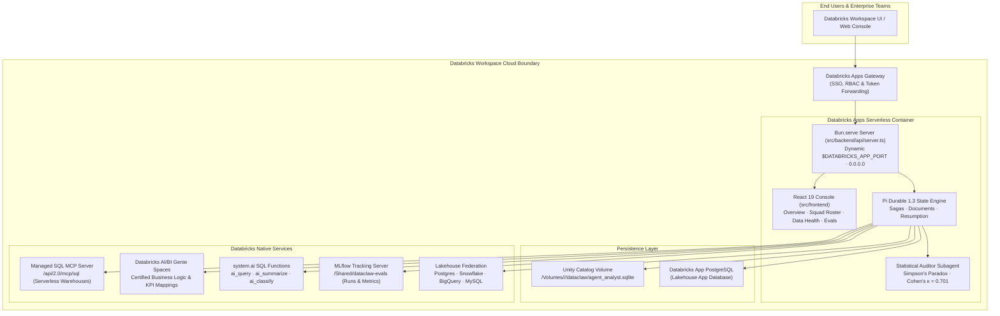

# DataClaw 🦀
### The Autonomous Data & AI Specialist Swarm for Databricks Lakehouse

[](https://docs.databricks.com/en/dev-tools/databricks-apps/index.html)
[](https://docs.databricks.com/en/data-governance/unity-catalog/index.html)
[](https://mlflow.org)
[](https://docs.databricks.com/en/genie/index.html)
[](https://bun.sh)
[](https://www.typescriptlang.org)
[](bun%20test)
[](https://github.com/earendil-works/pi-durable)
[](docs/DATABRICKS_APPS.md)

**DataClaw** is the open-source, enterprise-grade AI analytics swarm engineered natively for the **Databricks Lakehouse Platform**. Distributed as a serverless **Databricks App** via Databricks Asset Bundles (DAB), DataClaw runs entirely within your customer cloud perimeter with **100% zero data egress**, full Unity Catalog governance, and crash-resilient durability.

---

> 🚀 **Deploy in 60 Seconds on Databricks Apps**: See [**docs/DATABRICKS_APPS.md**](docs/DATABRICKS_APPS.md) for 1-click Databricks Asset Bundle (DAB) deployment, Unity Catalog Volume persistence, and Service Principal M2M authentication.
> 
> 🔬 **Architecture & Statistical Deep-Dive**: See [**docs/ARCHITECTURE_DOSSIER.md**](docs/ARCHITECTURE_DOSSIER.md) for the complete engineering dossier, clustered statistical power analysis ($ICC = 0.150$), and blind Cohen's $\kappa$ auditor calibration.

---

## Why DataClaw on Databricks?

Conventional data assistants and generic LLM wrappers fail in enterprise data organizations because they lose state across turns, jump to spurious statistical correlations, execute unbounded SQL error loops, and require sending proprietary customer data outside your cloud perimeter.

DataClaw operates as an autonomous, disciplined data analytics squad inside your Databricks workspace:

| Feature | Generic LLM Chatbots | Standalone BI & Dashboards | Raw AI/BI Genie | DataClaw Swarm |
| :--- | :--- | :--- | :--- | :--- |
| **Data Perimeter** | Egresses data to 3rd-party APIs | Stays in warehouse | Stays in Databricks | **100% In-Perimeter (Zero Egress)** |
| **State & Checkpoints** | Ephemeral, lost on refresh | Static reports | Ephemeral chat | **Pi Durable SQLite WAL / UC Volume** |
| **Statistical Rigor** | P-hacking & hallucinated numbers | Fixed static aggregations | Ad-hoc text queries | **Autonomous Auditor (Cohen's $\kappa=0.701$)** |
| **SQL Safety Boundary** | Raw SQL prompt injection risks | Managed BI queries | Read-only SQL | **Read-Only AST Validation & Enforced Scopes** |
| **Databricks Platform** | Unaware of Databricks primitives | JDBC / ODBC driver only | Genie spaces only | **Genie + MLflow + system.ai + Federation + App DB** |
| **Multi-Agent Roster** | Single generalist prompt | None | None | **Specialist Swarm (Scouts, SQL, Critics, DBA)** |
| **Continuous Learning** | Session amnesia | Manual analyst notes | None | **Closed-loop versioned playbook auto-improvement** |

---

## Databricks Native Architecture



---

## The Specialist Squad for Databricks Lakehouse

DataClaw coordinates a pre-configured, role-specialized swarm of data agents. Each specialist has its own private workspace, memory, tools, and durable conversation history:

1. 🔍 **Lakehouse Scout & Architect**: Navigates Unity Catalog metastores, schemas, tables, and Lakehouse Federation foreign connections. Generates automated data profiles and column distributions.
2. ⚡ **Delta Lake & SQL Optimizer**: Writes performant, non-mutating Delta Lake SQL. Enforces liquid clustering, partition pruning, and Z-Ordering heuristics while blocking destructive operations.
3. 🛡️ **Statistical Auditor Subagent**: A skeptical, task-owned critic subagent. Automatically challenges analytical findings for small sample sizes ($N < 30$), p-hacking, selection bias, and Simpson's Paradox before findings are committed.
4. 🧠 **AI/BI Genie Semantic Partner**: Interfaces with curated Databricks Genie spaces to cross-reference natural language questions with official corporate KPI definitions and certified SQL.
5. 📊 **MLflow & Model Evaluator**: Benchmarks agent quality, computes statistical power ($ICC = 0.150$, $VIF = 1.60\times$), detects stuck loops, and logs eval runs directly to workspace MLflow experiments.
6. 🗄️ **Lakehouse App DBA**: Manages state, schema migrations, and durable sessions inside the attached Databricks Lakehouse App Database (PostgreSQL).

---

## 60-Second Quickstart

### Option 1: Deploy to Databricks Apps (Asset Bundle)

Deploy directly into your Databricks workspace using the official Databricks CLI and Databricks Asset Bundles (DAB):

```bash
# 1. Clone the repository
git clone https://github.com/matheusbuniotto/dataclaw.git
cd dataclaw

# 2. Authenticate with your Databricks workspace profile
databricks auth login --profile dev

# 3. Validate and deploy the bundle
databricks bundle deploy -t dev

# 4. View your live app in Databricks
databricks apps get dataclaw --profile dev
```

### Option 2: Local Development with Databricks Connection

Run DataClaw locally connected to your live Databricks Unity Catalog:

```bash
# 1. Install dependencies
bun install

# 2. Authenticate Databricks CLI
databricks auth login --profile DEFAULT

# 3. Start the console
bun run server
# Open http://localhost:3000/console
```

---

## Databricks Native Platform Features

### 1. Unity Catalog Managed SQL MCP
DataClaw connects over streamable HTTP to Databricks' internal SQL MCP server (`/api/2.0/mcp/sql`).
- **Read-Only by Construction**: Every statement passes through AST validation and dialect security checks (`execute_sql_read_only`), rejecting `DROP`, `DELETE`, `UPDATE`, or multi-statement injections before reaching the warehouse.
- **Native Statistics**: Uses Databricks SQL primitives (`corr()`, `percentile_approx()`, `APPROX_COUNT_DISTINCT()`) for sub-second profiling.

### 2. Databricks AI/BI Genie Spaces
- Directly consults enterprise Genie spaces (`databricks_genie_ask`, `databricks_genie_list`).
- Bridges the gap between conversational questions and certified, human-verified semantic metrics.

### 3. Unity Catalog `system.ai` SQL Functions
- Leverages native Lakehouse AI functions inside analytical SQL queries:
  - `ai_query()`: Foundation model inference directly within SQL.
  - `ai_summarize()`: Condenses unstructured text columns (support tickets, customer reviews).
  - `ai_classify()`: Categorizes data into predefined taxonomy classes.
  - `ai_similarity()`: Computes semantic cosine distance between text entities.
  - `ai_mask()`: Masks PII/sensitive data dynamically before analytical presentation.

### 4. Workspace MLflow Tracking & Evals
- Evaluates analytical performance and logs scores, parameters, and Git commit metadata directly to Databricks MLflow tracking server (`/Shared/dataclaw-evals`).
- Integrates with the production stuck detector: flags repeated queries ($\ge 3$), error streaks ($\ge 3$), and token budget overruns.

### 5. Lakehouse Federation Connections
- Automatically discovers and queries foreign data sources registered in Unity Catalog (PostgreSQL, Snowflake, Google BigQuery, MySQL, Redshift).
- Enables cross-lakehouse queries without moving data.

### 6. Databricks Lakehouse App Database (PostgreSQL)
- Automatically mounts the Databricks App internal PostgreSQL instance (`PGHOST`, `PGDATABASE`) for high-concurrency multi-tenant state storage and collaborative session management.

---

## Statistical Rigor, Stuck Detection & Evaluation Methodology

DataClaw does not rely on subjective LLM self-evaluation. It enforces a strict, reproducible statistical framework:

### 1. Production Stuck Detector
Runs continuously over active and offline execution traces without needing ground truth:

| Signal | Definition | Action Taken |
| :--- | :--- | :--- |
| `repeated_call` | Identical tool arguments $\ge 3$ times | Aborts query loop; prompts alternative strategy |
| `error_streak` | $\ge 3$ consecutive tool/SQL errors | Pauses run; alerts user with actionable error context |
| `tool_budget` | $> 25$ tool calls in one turn | Intervenes before runaway token exhaustion |
| `no_final_answer` | Run terminates without answer or aborts | Flags run for post-mortem analysis |

### 2. Calibrated Auditor Subagent (LLM-as-a-Judge)
Every finding is reviewed by the skeptical Auditor subagent:
- Evaluates statistical validity, sample sizes ($N \ge 30$), effect sizes (Cohen's $h$), and Simpson's Paradox.
- **Blind Calibration**: Scored against double-blind human ground-truth labels using **Cohen's kappa ($\kappa = 0.701$)** with percentile bootstrap confidence intervals.

### 3. Statistical Power Analysis
Repeated evaluations resample tasks (clusters), not individual runs:
- Intra-cluster correlation ($ICC = 0.150$).
- Variance Inflation Factor ($VIF = 1.60\times$).
- Run `bun run evals:power` to calculate Minimum Detectable Effect (MDE) before shipping model or prompt updates.

---

## Repository Architecture

The codebase is organized as a clean **modular monolith** with strict domain isolation:

```
dataclaw/
├── src/
│   ├── frontend/                    # UI Domain (React 19 + TypeScript)
│   │   ├── pages/                   # Overview, Agents, Runs, Data Health, Capabilities, Settings
│   │   ├── components/squad/        # Specialist sidebar, avatar, org-view, and grouping
│   │   ├── components/inspector/    # Workspace inspector & statistical approval cards
│   │   ├── components/composer/     # Action capsule prompt composer
│   │   ├── components/auth/         # Databricks OAuth & Service Principal credentials
│   │   ├── styles/                  # Theme styling, motion, and layout
│   │   └── DurableAgentConsole.tsx  # Interactive console application shell
│   │
│   ├── backend/                     # Server & Domain API
│   │   ├── api/server.ts            # Bun.serve HTTP server (dynamic $PORT, 0.0.0.0 binding)
│   │   ├── api/routes.ts            # Declarative /api/* route table
│   │   ├── api/databricks-api.ts    # Databricks OAuth, status, Genie, Connections & MLflow APIs
│   │   ├── api/workspace.ts         # Agent sessions, reports, and source tracking
│   │   └── api/capabilities-api.ts  # Dynamic plugins, skills, and catalog management
│   │
│   ├── adapters/                    # Lakehouse & Data Adapters
│   │   ├── databricks-adapter.ts    # Unity Catalog SQL MCP adapter (read-only AST validation)
│   │   ├── postgres-adapter.ts      # Lakehouse App DB (PostgreSQL) adapter
│   │   └── sqlite-adapter.ts        # Fast local CSV/JSON/SQLite analysis engine
│   │
│   ├── mcp/                         # Databricks Platform Native Clients
│   │   ├── databricks-genie.ts      # AI/BI Genie spaces & message client
│   │   ├── databricks-mlflow.ts     # MLflow experiments, runs, and eval scores client
│   │   ├── databricks-system-ai.ts  # Unity Catalog system.ai functions client
│   │   ├── databricks-connections.ts# Lakehouse Federation connections discovery
│   │   ├── databricks-env.ts        # Databricks Apps runtime environment resolver
│   │   ├── databricks-oauth.ts      # Browser PKCE & Service Principal M2M OAuth
│   │   └── mcp-sql-client.ts        # Streamable HTTP MCP JSON-RPC client
│   │
│   ├── tools/                       # Replayable Pi Durable Agent Tools
│   │   ├── databricks-features-tools.ts # Genie, system.ai, MLflow & connection tools
│   │   ├── databricks-tools.ts      # Unity Catalog profiling and SQL tools
│   │   ├── agent-tools.ts           # Specialist creation, delegation, and inspection
│   │   └── feature-tools.ts         # Runtime skill & plugin generation
│   │
│   ├── docs/                        # Durable Document Schemas (defineDoc)
│   │   ├── plan.ts                  # AnalystPlanDoc (active goal, hypotheses)
│   │   ├── findings.ts              # FindingsDoc (verified insights & audit verdicts)
│   │   ├── playbook.ts              # PlaybookDoc (versioned heuristics & rules)
│   │   └── agents.ts                # AgentRosterDoc (specialist profiles & delegated runs)
│   │
│   ├── tasks/                       # State Machine Sagas (defineTask)
│   │   ├── analysis-workflow.ts     # AnalysisWorkflowTask (Intake -> Query -> Audit -> Memo)
│   │   └── auto-improvement.ts     # AutoImprovementTask (Feedback -> Distill -> Upgrade)
│   │
│   └── compute/                     # Specialist Sandboxed Compute
│       ├── agent-compute.ts         # Isolated workspace homes per specialist
│       └── docker-env.ts            # Optional scale-to-zero container runner
│
├── deploy/                          # Databricks Deployment Assets
│   └── databricks/
│       ├── deploy.sh                # Automated 1-click Asset Bundle deployer
│       └── start.sh                 # Container entrypoint ensuring Bun runtime
│
├── app.yaml                         # Databricks Apps runtime manifest
├── databricks.yml                   # Databricks Asset Bundle (DAB) declaration
├── evals/                           # Evaluation & benchmarking suite
└── tests/                           # 344 Unit & integration tests (100% green)
```

---

## Verification & Testing

Every commit is strictly verified against type safety and end-to-end integration:

```bash
# 1. Typecheck entire codebase (0 errors)
bun run typecheck

# 2. Run test suite (344 tests passing)
bun test

# 3. Run evaluation benchmarking suite
bun run evals

# 4. Validate Databricks Asset Bundle
make dab-validate
```

---

## License

Apache-2.0 License. Built for the global Databricks and open-source data community. Contributions and PRs welcome!
